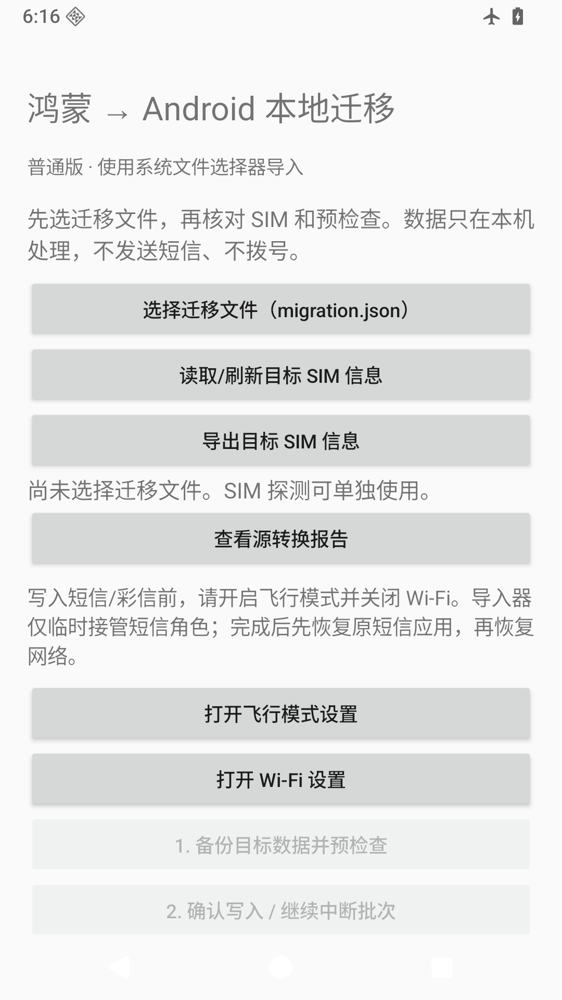
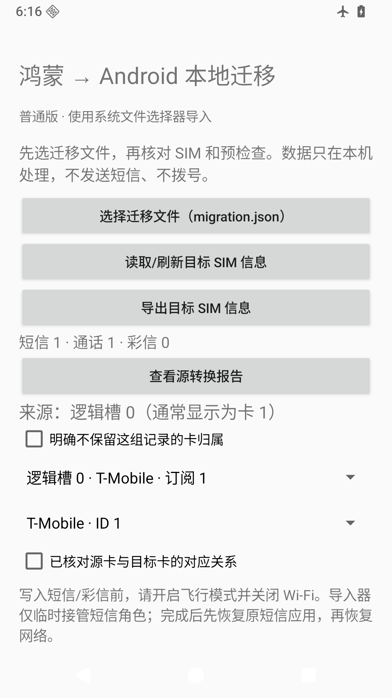

# 从备份到迁移完成

## 1. 准备

在鸿蒙手机的系统备份应用中，将短信和通话记录备份到 U 盘/本地介质。记住备份密码。将备份连接电脑，找到包含 `.info.json` 或 `info.json` 以及 `files` 的那一级目录。工具按实际格式识别，不保证所有系统版本。

在目标 Android 上先使用自己熟悉的方式做完整备份。确认有足够可用空间；安装器需要 Android 12+、设备主用户。普通版无需 USB 调试。涉及短信时请安排一个短暂离线窗口，避免临时默认短信应用影响新消息。

## 2. 选择导入方式

- 希望自己选文件：下载 Release 的 `standard.apk`；电脑转换为 native JSON。
- 希望电脑读取 SIM 和传入：下载同一 Release 的 `usb.apk`，安装官方 Platform-Tools，打开 USB 调试并在目标手机确认电脑授权。
- 已使用 SMS Backup & Restore：转换成其 XML，再由该应用恢复。第三方应用的去重与卡标签行为不由本工具控制。

电脑端安装和 `wizard` 向导命令见 [README](../README.md)。密码只在本地隐藏输入。转换器不会主动写入目标手机。

## 3. 核对来源卡与目标卡

目标信息可来自 USB、安装器现场读取、手工配置，或目标短信/通话备份样本。样本任选一个或同时提供；它们只提供格式与账户候选，原有通信内容不会混入新文件。

来源“逻辑槽 0”通常是卡 1，“逻辑槽 1”通常是卡 2。历史换卡和 eSIM 场景要另行核对。目标订阅 ID 是短信使用的内部 ID，通话使用账户 ID 与组件，二者即使同数字也不能直接视为对应。只提供通话样本不能推导短信订阅 ID。

在安装器中选中每个来源组对应的订阅和电话账户，确认后勾选“已核对”。选择不保留卡归属、或将多张来源卡合并到一个账户，均需明确确认。

截图来自隔离模拟器，仅使用合成数据。实体手机的运营商和 SIM 标签不同。

## 4. 备份、预检查和写入

涉及短信/彩信时，开启飞行模式并关闭 Wi-Fi。选择文件后点击“备份目标数据并预检查”，按手机提示授予临时默认短信角色和需要的权限。只迁移通话不需要临时短信角色或离线窗口。

查看新增、已有、冲突及未支持项。默认不会接受部分转换或跨卡相似记录；先查报告，再决定是否继续。导出并保存目标备份与报告后，点击“确认写入 / 继续中断批次”。不要在批次运行时切换安装包、换卡或清除应用数据。

导入采取追加策略，不会清空目标原有短信/通话。它没有一键全库回滚功能；导出的快照用于核验和人工恢复，不是厂商系统备份包。

## 5. 核验、恢复和清理

查看完成状态和类别数量，抽查日期、内容、通话方向、彩信图片及两张卡的记录。数据库映射正确不保证每个 ROM 的通话列表都会显示卡标签，界面需单独抽查。

点击“恢复原默认短信应用”，在系统设置中选回常用短信应用；工具不能替用户自动切回。核对成功后恢复网络。若原应用无法识别，按界面提示人工确认，不要把“导入器已不再默认”误认为原应用一定恢复。

“结束当前批次”不删除历史输入、备份或日志。待处理消息/彩信通知可能阻止结束；导出只保存证据，不代表已处理通知或下载了彩信。先恢复常用应用并人工核实。确认不再需要续传后，才清除本工具数据/卸载；电脑与外部导出的副本另行管理，见[隐私说明](../PRIVACY.md)。
